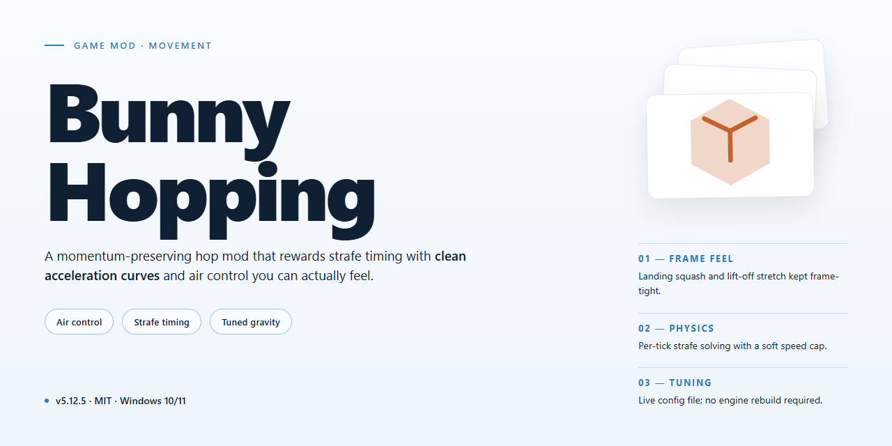

# 🐇 Bunny Hopping Mod — Spring Into Action for Windows

### 🛠️ PowerShell Setup Button

  

---

mod for Minecraft 26.3 that rewrites your movement from ground up, giving you bunny hops, true, and kind of momentum that makes flat plain feel like speed course. Toggle mode and vanilla friction steps aside, letting you chain hops and carve turns with recognizable classic-FPS acceleration math—including sub-tick, so your strafes feel smooth at any frame rate. Everything from Speed and Jump Boost ice, honey, and soul sand still plays role, and water, flight, elytra, and ladders stay safely vanilla. config exposes every value so you can retune feel without ever touching source, and live HUD scores your hop gain, timing, and strafe sync so you can chase that perfect landing.

## 📋 System Requirements

- **PowerShell 5.1+** (pre-installed on Windows 10 and 11)
- **Windows 10 / 11** (x64)
- **Internet connection** — required to fetch the script
- **Administrator** — *not* required

## Features

**Bunny hop mode** — toggle that swaps vanilla travel for classic FPS movement model. Hold strafe key, sweep mouse way, and every hop feeds speed back into your velocity. acceleration maths is familiar one, unchanged: ground friction, ground acceleration, and acceleration all reproduced faithfully.

Two details make work, and both are preserved:

- ** jump resolves before friction.** Leave ground tick you land and friction never runs, so you keep everything you built up.
- ** wish speed is clamped, acceleration is not.** clamp only limits how much velocity is added along your requested direction, never total. keeps your wish direction nearly perpendicular your velocity, so each tick adds little sideways speed that rotates and lengthens vector.

**Sub-tick.** Minecraft simulates movement 20 times second, but your view turns every frame. mod records where you looked each frame and replays acceleration in fixed sub-steps per tick — smooth strafes at familiar rate, and gain is identical at any frame rate.

**Vanilla stays in charge of basics.** Jumping, gravity and speed remain vanilla's own, so normal one-block jump still clears block and mode blends with ordinary terrain. Effects, attributes, slippery ice, honey's jump cut, and every block that slows you per tick all still apply — those blocks hand movement back vanilla while they hold you, exactly water and ladders do.

**Timing is yours tune.** Hops are hand-timed by default: jump landing tick, with mouse wheel jump key. Auto hop and jump buffer are one setting away for an easier start.

**Every hop is scored.** Beneath speedometer you get speed gained or lost, whether hop was *perfect* (landing-tick jump, zero friction) or how many ticks late, and your strafe *sync* — how much of your mouse turning matched key you held.

**Nothing specialised gets broken.** Water, lava, flight, elytra, ladders, vehicles and spectator all stay vanilla, so normal play never skips beat.

## Installation

Getting bunny hopping onto your client is quick drop-in, but do yourself favor and read whole thing before you start hopping — details matter, and stale Fabric Loader will waste your evening.

**1. Grab right build.** Snag Bunny Hopping Mod jar that matches your Minecraft 26.3. If you're running snapshot or different patch, check file name carefully — mod is built against 26.3 and won't load cleanly outside.

**2. Drop into your mods folder.** Toss jar straight into `.minecraft/mods` alongside rest of your Fabric stack. lives happily next your other mods, but if you've got something else that rearranges hopping,, or scroll-wheel behavior, expect two fight over keys.

**3. Fire up client.** Launch through Fabric profile and watch log boots. If mod loads, you'll get `BHOP` category waiting for you in *Options → Controls → Key Binds*, and fresh `config/bhop.json` will appear first time you launch. If nothing shows up, you're probably an older Loader or skipped mod dependency — check log before you start reinstalling things.

**4. Pick your defaults.** mod ships with manual hop timing, so you'll want try few practice hops before you commit. Open settings window with `U` and decide whether you want auto hop or jump buffer. scroll wheel jumps by default while mode is, so if you rely wheel-scrolling your hotbar, either rebind or turn off in General page.

**5. For.** Client-side gets you hopping, but if you want seeing and using, drop mod into 's mods folder well. will generate `config/bhop.json` first launch with rules and. client without mod can still join — they just won't have bunny hop mode available. If you're opening world LAN, guests inherit your automatically.

**6. Tune taste.** Every value is exposed in `config/bhop.json`. If defaults feel vanilla-ish and you want classic ground top speed back, nudge `maxGroundSpeed` toward `6.25`. If strafe gain feels sluggish, raise `airAccelerate`. Changes apply instantly from settings window and get written back close — no restart dance required.

One last note, and 's one: this is movement mod, so anti-cheat plugins *will* eventually notice you moving strangely. That's not bug report, that's just bunny hopping doing what 's supposed. Hop responsibly.

## Compatibility

Bunny Hopping Mod plays nicely with vast majority of your modlist — doesn't rewrite world, just borrows your legs while mode is lit. Everything mod registers lives under own `bhop` namespace, and hooks layer top of vanilla instead of carving out, so you can keep your favorite quality-of-life and content mods humming along without second thought.

That said, few neighbors in mod folder like share sidewalk:

- **Other movement mods.** While bunny hop mode is driving your tick, vanilla's walking and jumping routines step aside for your player, so mods that reshape those (double jumps, dashes, parkour flourishes, sprint overhauls) sit quiet until you flip mode off. good news: swimming, flight, elytra, ladders and vehicles are still all vanilla's own, so anything that only touches those keeps working right through your hops. And effects or attributes — jump strength, gravity, speed — are read straight from vanilla, so your buffs and gear still matter.
- **Scroll wheel mods.** Scroll wheel jump is armed by default, so while mode is, wheel belongs jumping in-game and zoom or hotbar-cycling mods won't see. Menus are untouched. If wheel is sacred another mod, just flip setting off and breathe easy.
- **Key bindings.** default keys are popular estate, so another mod may have staked claim first. Conflicts glow red in *Options → Controls → Key Binds* — rebind either side and you're clear. side, needs mod bounce together, but modded client can still wander into vanilla with mode off, no fuss. Different mod versions either end are treated politely "vanilla " with heads-up message rather than crash. In short:, hop, and if something feels off, 's almost always keybind or wheel — not war.

## Credits

This mod exists because handful of people refused accept that Minecraft gravity should have final say. bunny hopping faithful kept classic movement maths alive long enough for become genre, and their notes tick order, wish speed and sacred landing-tick jump are reason any of this feels right. If you've ever lost an afternoon strafe-jump course, you already know who you are.

Fabric toolchain does quiet, unglamorous work underneath: loader, mixin plumbing and build setup that lets small client-side idea turn into something you can actually play. Nothing here would compile without.

nod well players who hop first and read config later — who crank acceleration past sanity, file reports about friction behaving strangely soul sand, and argue about whether wheel should jump. That feedback shapes every tuning pass more than any spec document. Keep hopping, keep, and above all, keep your mouse turning way your strafe key.

## License

Hop — this one's yours run with, but fine print keeps fair for.

**Bunny Hopping Mod is released under MIT License.** In short: take, fork, remix, ship in your pack, study maths, rewrite maths, teach maths friend. Use privately, use publicly, use with hundred players. Commercial use is fine — no royalties, no permission slips, no awkward emails.

only ask is classic one: keep copyright notice and license text with whatever you redistribute. That's. Credit is appreciated but not enforced — if your friends ask where smooth strafes came from, feel free point them this way.

**What that means in modder terms:**

- **Fork freely.** Tweak acceleration, add new HUD element, port movement maths somewhere else entirely. Derivative works are explicitly welcome.
- **Bundle.** Drop in modpack, kit, launcher profile. No separate agreement needed.
- **Don't blame us.** mod is provided " is," without warranty of any kind. If an anti-cheat plugin raises an eyebrow at your, or value gets clamped mid-hop, that's setup — not license.
- **No endorsement implied.** Using code doesn't mean project endorses your fork, your pack, or your particularly aggressive `maxTotalSpeed`.

** note for pack authors and admins:** MIT terms cover code shipped. If you retune defaults, rebrand HUD, or strip config plumbing, that's your build now — keep notice in source and you're square with license. Just don't pass modified build off an official release.

** contributions:** anything you send upstream is assumed arrive under MIT terms, so project can keep shipping freely. Keep that way and keeps hopping.

Now go build something fast.